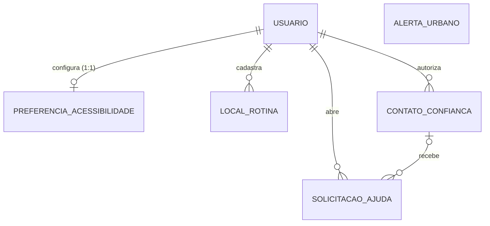

# CIVIA API: backend da CitizenTech de acessibilidade urbana

Global Solution FIAP 2026.2, turma 3ESPS. Disciplina: **Arquitetura Orientada a Serviços (SOA) e Web Services**.

## Integrantes

| Nome | RM |
|---|---|
| Ana Luiza Santana da Rocha | 561194 |
| Evandro Yuji Kaibara de Oliveira | 559274 |
| Guilherme Rodrigues Leite | 560131 |
| Pedro Henrique Batista Bergamin | 559443 |
| Luís Filipe Crivellaro | 560877 |

## Descrição da solução

O CIVIA é uma proposta de tecnologia assistiva para pessoas cegas, com baixa visão, surdas ou com perda auditiva em seus deslocamentos urbanos. A proposta combina óculos inteligentes, aplicativo móvel e assistência humana autorizada, com o lema "a cidade se adapta a você".

Este repositório contém a **camada de backend** da solução: uma API REST em ASP.NET Core que guarda e disponibiliza os dados que o aplicativo usaria:

- cadastro do usuário e de suas **preferências de acessibilidade** (áudio, vibração, legenda ou recursos visuais);
- **locais de rotina** definidos pelo próprio usuário (casa, trabalho, estações);
- **contatos de confiança** autorizados a receber pedidos de ajuda;
- **solicitações de ajuda e SOS**, com ciclo de status controlado;
- **alertas urbanos** (obras, elevadores indisponíveis, alagamentos, mudanças de plataforma).

**Escopo.** É uma implementação acadêmica de funcionalidades selecionadas da proposta. Não fazem parte desta API: integração com os óculos inteligentes, reconhecimento visual, navegação em tempo real, envio real de notificações, integrações com transporte público e autenticação. Todos os dados usados nos testes são simulados.

## Tecnologias

- C# e ASP.NET Core Web API (.NET 10 LTS)
- Entity Framework Core 10 com SQL Server (desenvolvido e testado no SQL Server 2022 LocalDB)
- Migrations do EF Core
- OpenAPI 3.0.3, Swagger UI (Swashbuckle) e Insomnia

## Como a solução foi construída (contract-first)

Seguindo a abordagem do Case Final da disciplina, o contrato foi escrito **antes** do código:

1. **Contrato:** [`docs/openapi.yaml`](docs/openapi.yaml), com recursos, rotas, schemas reutilizados via `$ref`, exemplos e um formato único de erro (RFC 7807, Problem Details).
2. **Implementação:** entidades, `DbContext` e controllers seguindo o contrato.
3. **Verificação de contract drift:** o script [`scripts/comparar-contrato.ps1`](scripts/comparar-contrato.ps1) compara cada combinação de rota, método e status code do contrato com o OpenAPI gerado pelo código. Resultado em [`evidencias/04-comparacao-contrato.txt`](evidencias/04-comparacao-contrato.txt): 65 combinações nos dois lados, nenhuma divergência.

Com a API rodando, o Swagger UI (`http://localhost:5080/swagger`) mostra as duas definições lado a lado no seletor "Select a definition": a API implementada e o contrato escrito antes do código.

## Estruturação do domínio



| Entidade | Principais atributos | Relacionamento |
|---|---|---|
| `Usuario` | nome, email (único), tipoDeficiencia | raiz do domínio |
| `PreferenciaAcessibilidade` | canalPrincipal, vibracaoAtiva, altoContraste, priorizarElevador | 1:1 com Usuario |
| `LocalRotina` | nome, tipo, endereco, latitude, longitude | N:1 com Usuario |
| `ContatoConfianca` | nome, telefone, relacao, ativo | N:1 com Usuario |
| `SolicitacaoAjuda` | tipo (AJUDA ou SOS), status, mensagem, latitude, longitude | N:1 com Usuario e N:1 opcional com ContatoConfianca |
| `AlertaUrbano` | titulo, descricao, tipo, local, ativo | independente |

**Decisões de modelagem**

- **Ajuda e SOS** são uma única entidade com um campo `tipo`, porque têm os mesmos dados e o mesmo ciclo de vida.
- **Preferências** ficam numa tabela própria em relação 1:1, garantida por índice único em `UsuarioId`.
- **Orientação de trajetos** não virou entidade: depende de mapas e GPS em tempo real, fora do escopo. A API guarda os dados que a orientação usaria (locais, preferências e alertas).
- **Enums** são gravados como texto (`EM_ATENDIMENTO`, `BAIXA_VISAO`), com os mesmos valores do JSON e do contrato.

**Regras de negócio**

1. O email do usuário é único (409 se repetido).
2. Uma solicitação `AJUDA` exige um contato de confiança ativo e do mesmo usuário (400 caso contrário).
3. Um `SOS` exige latitude e longitude, a "última localização conhecida" (400 caso contrário).
4. Status da solicitação: `ABERTA → EM_ATENDIMENTO → CONCLUIDA`, e `ABERTA` ou `EM_ATENDIMENTO → CANCELADA`. `CONCLUIDA` e `CANCELADA` são finais; outra transição retorna 409. A regra fica na própria entidade (`SolicitacaoAjuda.AlterarStatus`).
5. Excluir um usuário remove em cascata as preferências, os locais, os contatos e as solicitações dele.
6. Um contato que já recebeu solicitações não pode ser excluído (409); ele deve ser desativado com `ativo = false`, preservando o histórico.

## Endpoints

Base: `http://localhost:5080/api`. Documentação completa no contrato e no Swagger UI.

| Recurso | Endpoints |
|---|---|
| Usuários | `GET, POST /usuarios` · `GET, PUT, DELETE /usuarios/{usuarioId}` |
| Preferências | `GET, PUT /usuarios/{usuarioId}/preferencias` (PUT cria ou atualiza, idempotente) |
| Locais de rotina | `GET, POST /usuarios/{usuarioId}/locais` · `GET, PUT, DELETE /usuarios/{usuarioId}/locais/{localId}` |
| Contatos de confiança | `GET, POST /usuarios/{usuarioId}/contatos` · `GET, PUT, DELETE /usuarios/{usuarioId}/contatos/{contatoId}` |
| Solicitações de ajuda | `GET (?status=), POST /usuarios/{usuarioId}/solicitacoes` · `GET .../{solicitacaoId}` · `PATCH .../{solicitacaoId}/status` |
| Alertas urbanos | `GET (?tipo=&ativo=), POST /alertas` · `GET, PUT, DELETE /alertas/{alertaId}` |

Status usados: 200 leitura e atualização, 201 criação (com header `Location`), 204 exclusão, 400 dados inválidos, 404 não encontrado, 409 conflito com regra de negócio. Todos os erros seguem o formato Problem Details:

```json
{
  "title": "Dados inválidos",
  "status": 400,
  "instance": "/api/usuarios/1/solicitacoes",
  "errors": { "contatoConfiancaId": ["O contato 2 está inativo e não pode receber solicitações."] }
}
```

## Estrutura do repositório

```
Civia.sln
dotnet-tools.json            ferramenta dotnet-ef (versão fixa do projeto)
Civia.Api/
  Models/                    entidades e enums do domínio
  Dtos/                      formatos de request/response e validações
  Data/CiviaDbContext.cs     mapeamento EF Core: tabelas, chaves, índices e regras de exclusão
  Migrations/                migration InitialCreate
  Controllers/               endpoints REST
  Program.cs                 configuração da API, banco, Swagger e formato de erros
docs/openapi.yaml            contrato OpenAPI (escrito antes do código)
insomnia/                    coleção do Insomnia e roteiro de testes
scripts/                     verificação do banco, do contrato e execução do roteiro
evidencias/                  saídas e capturas da aplicação funcionando
```

## Como executar

### Pré-requisitos

- [.NET SDK 10](https://dotnet.microsoft.com/download/dotnet/10.0)
- SQL Server: o projeto usa por padrão o **SQL Server Express LocalDB** (instância `(localdb)\MSSQLLocalDB`), instalado junto com o Visual Studio ou pelo instalador do SQL Server Express (opção LocalDB). Qualquer outra instância do SQL Server também funciona.
- [Insomnia](https://insomnia.rest/download) para os testes manuais

### Passo a passo

```bash
git clone <url-do-repositorio>
cd <pasta-do-repositorio>
dotnet tool restore
dotnet ef database update --project Civia.Api
dotnet run --project Civia.Api --launch-profile http
```

- `dotnet tool restore` instala a ferramenta `dotnet-ef` na versão do projeto.
- `dotnet ef database update` cria o banco `CiviaDb` e todas as tabelas a partir da migration.
- A API sobe em `http://localhost:5080` e o Swagger UI em `http://localhost:5080/swagger`.

### Configuração do banco

A connection string fica em `Civia.Api/appsettings.json`:

```json
"ConnectionStrings": {
  "CiviaDb": "Server=(localdb)\\MSSQLLocalDB;Database=CiviaDb;Trusted_Connection=True;TrustServerCertificate=True"
}
```

Para usar outra instância, altere o valor `Server`. Exemplos: `localhost\\SQLEXPRESS` para o SQL Server Express completo, ou `localhost,1433;User Id=sa;Password=...` para SQL Server em Docker.

### Migrations

| Ação | Comando |
|---|---|
| Aplicar as migrations (cria ou atualiza o banco) | `dotnet ef database update --project Civia.Api` |
| Criar uma nova migration após mudar o modelo | `dotnet ef migrations add NomeDaMudanca --project Civia.Api` |
| Recriar o banco do zero | `dotnet ef database drop --force --project Civia.Api` e depois `database update` |
| Conferir tabelas, chaves e registros no banco | `powershell -ExecutionPolicy Bypass -File scripts\verificar-banco.ps1` |

A migration `InitialCreate` cria 6 tabelas, 5 chaves estrangeiras e 2 índices únicos (email do usuário e relação 1:1 das preferências).

## Testes manuais com Insomnia

1. Recrie o banco para que os ids comecem em 1: `dotnet ef database drop --force --project Civia.Api` e `dotnet ef database update --project Civia.Api`.
2. Suba a API.
3. No Insomnia, importe `insomnia/civia-insomnia.json` (Import, From File).
4. Execute as requisições **em ordem**, de 01 a 45. O nome de cada requisição traz o status esperado entre parênteses, por exemplo `03 Email já cadastrado (409)`.

A coleção tem 45 requisições em 7 pastas (Usuários, Preferências, Locais de rotina, Contatos de confiança, Solicitações de ajuda, Alertas urbanos e Exclusão em cascata). Ela cobre cadastros, consultas, filtros, atualizações e exclusões, e também os erros: validação (400), recurso inexistente (404), email repetido, transição de status inválida e contato com histórico (409).

O mesmo roteiro pode ser executado automaticamente para conferência: `powershell -ExecutionPolicy Bypass -File scripts\executar-roteiro.ps1`.

## Evidências

| Arquivo | Conteúdo |
|---|---|
| [`evidencias/01-migration-comandos.txt`](evidencias/01-migration-comandos.txt) | Saída dos comandos de criação e aplicação da migration |
| [`evidencias/02-roteiro-automatico.md`](evidencias/02-roteiro-automatico.md) | Execução das 45 requisições do roteiro, com requisição, resposta e status (45 de 45 com o status esperado) |
| [`evidencias/03-banco-estrutura-e-dados.txt`](evidencias/03-banco-estrutura-e-dados.txt) | Tabelas, colunas, chaves estrangeiras, índices e registros gravados no SQL Server |
| [`evidencias/04-comparacao-contrato.txt`](evidencias/04-comparacao-contrato.txt) | Comparação entre o contrato e a API implementada |
| [`evidencias/05-swagger-api-implementada.png`](evidencias/05-swagger-api-implementada.png) | Swagger UI da API em execução |
| [`evidencias/06-swagger-contrato.png`](evidencias/06-swagger-contrato.png) | Swagger UI exibindo o contrato escrito antes do código |
| `evidencias/insomnia/` | Capturas de tela da coleção executada no Insomnia, uma por requisição (feitas pela equipe) |
