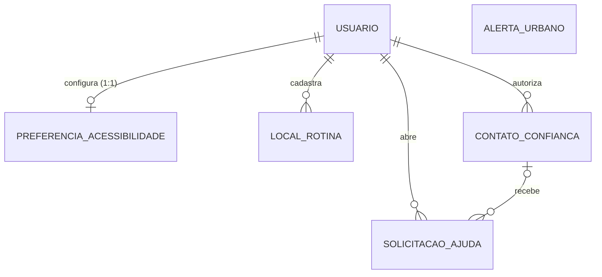

# CIVIA API

Backend do projeto CIVIA, desenvolvido para a Global Solution 2026.2 da FIAP (turma 3ESPS), na disciplina de Arquitetura Orientada a Serviços (SOA) e Web Services.

## Integrantes

- Ana Luiza Santana da Rocha - RM 561194
- Evandro Yuji Kaibara de Oliveira - RM 559274
- Guilherme Rodrigues Leite - RM 560131
- Pedro Henrique Batista Bergamin - RM 559443
- Luís Filipe Crivellaro - RM 560877

## Sobre o projeto

O CIVIA é uma proposta de tecnologia assistiva para ajudar pessoas cegas, com baixa visão, surdas ou com perda auditiva a se locomoverem pela cidade. A ideia junta óculos inteligentes, um aplicativo e a ajuda de pessoas de confiança.

Neste repositório está só o backend: uma API REST em ASP.NET Core que guarda os dados que o aplicativo usaria. Ela permite cadastrar:

- usuários e suas preferências de acessibilidade (áudio, vibração, legenda, alto contraste);
- locais de rotina, como casa, trabalho e estações;
- contatos de confiança, que podem receber pedidos de ajuda;
- pedidos de ajuda e SOS, com controle de status;
- alertas da cidade, como obras, elevadores parados, alagamentos e mudança de plataforma.

Como é um trabalho acadêmico, implementamos apenas uma parte da proposta. A integração com os óculos, o reconhecimento de imagem, a navegação em tempo real, o envio de notificações e a autenticação ficaram de fora. Os dados usados nos testes são fictícios.

## Tecnologias

- C# com ASP.NET Core Web API (.NET 10)
- Entity Framework Core 10 e SQL Server (usamos o LocalDB)
- Migrations do EF Core
- OpenAPI 3.0, Swagger UI e Insomnia

## Contrato primeiro

Antes de começar o código, escrevemos o contrato da API em [`docs/openapi.yaml`](docs/openapi.yaml), com as rotas, os schemas, exemplos e o formato dos erros (Problem Details). Depois implementamos as entidades, o `DbContext` e os controllers seguindo esse contrato.

Para conferir se o código ficou igual ao contrato, o script [`scripts/comparar-contrato.ps1`](scripts/comparar-contrato.ps1) compara as rotas, métodos e status codes dos dois. O resultado está em [`evidencias/04-comparacao-contrato.txt`](evidencias/04-comparacao-contrato.txt) e não aponta diferenças.

Com a API rodando, dá para ver as duas versões no Swagger (`http://localhost:5080/swagger`), trocando no seletor "Select a definition".

## Modelo de dados



- `Usuario`: nome, email (único) e tipo de deficiência.
- `PreferenciaAcessibilidade`: canal principal, vibração, alto contraste e preferência por elevador. Cada usuário tem uma só.
- `LocalRotina`: nome, tipo, endereço e coordenadas. Pertence a um usuário.
- `ContatoConfianca`: nome, telefone, relação e se está ativo. Pertence a um usuário.
- `SolicitacaoAjuda`: tipo (AJUDA ou SOS), status, mensagem e coordenadas. Pertence a um usuário e pode estar ligada a um contato.
- `AlertaUrbano`: título, descrição, tipo, local e se está ativo. Não depende de usuário.

Algumas escolhas que fizemos:

- Ajuda e SOS ficaram na mesma tabela, com um campo `tipo`, porque guardam os mesmos dados.
- As preferências ficaram numa tabela separada, com índice único em `UsuarioId` para garantir uma por usuário.
- Não criamos uma entidade de rotas/trajetos, porque isso depende de GPS e mapas em tempo real. A API guarda só os dados que essa parte usaria.
- Os enums são salvos como texto (`BAIXA_VISAO`, `EM_ATENDIMENTO`), igual aparecem no JSON.

### Regras de negócio

1. Não pode haver dois usuários com o mesmo email (retorna 409).
2. Um pedido do tipo `AJUDA` precisa de um contato de confiança ativo do mesmo usuário (retorna 400).
3. Um `SOS` precisa de latitude e longitude (retorna 400).
4. O status do pedido segue `ABERTA → EM_ATENDIMENTO → CONCLUIDA`. Também é possível cancelar um pedido aberto ou em atendimento. Depois de concluído ou cancelado, o status não muda mais (retorna 409).
5. Ao excluir um usuário, as preferências, locais, contatos e pedidos dele também são excluídos.
6. Um contato que já recebeu pedidos não pode ser excluído (retorna 409). Nesse caso, ele deve ser desativado com `ativo = false`.

## Endpoints

Todas as rotas começam com `http://localhost:5080/api`.

| Recurso | Rotas |
|---|---|
| Usuários | `GET`, `POST /usuarios` e `GET`, `PUT`, `DELETE /usuarios/{usuarioId}` |
| Preferências | `GET`, `PUT /usuarios/{usuarioId}/preferencias` |
| Locais de rotina | `GET`, `POST /usuarios/{usuarioId}/locais` e `GET`, `PUT`, `DELETE /usuarios/{usuarioId}/locais/{localId}` |
| Contatos de confiança | `GET`, `POST /usuarios/{usuarioId}/contatos` e `GET`, `PUT`, `DELETE /usuarios/{usuarioId}/contatos/{contatoId}` |
| Pedidos de ajuda | `GET` (filtro `?status=`), `POST /usuarios/{usuarioId}/solicitacoes`, `GET .../{solicitacaoId}` e `PATCH .../{solicitacaoId}/status` |
| Alertas | `GET` (filtros `?tipo=` e `?ativo=`), `POST /alertas` e `GET`, `PUT`, `DELETE /alertas/{alertaId}` |

Status de resposta usados: 200, 201 (com header `Location`), 204, 400, 404 e 409. Os erros voltam neste formato:

```json
{
  "title": "Dados inválidos",
  "status": 400,
  "instance": "/api/usuarios/1/solicitacoes",
  "errors": { "contatoConfiancaId": ["O contato 2 está inativo e não pode receber solicitações."] }
}
```

## Estrutura de pastas

```
Civia.Api/
  Models/         entidades e enums
  Dtos/           objetos de entrada e saída, com validações
  Data/           DbContext
  Migrations/     migration inicial
  Controllers/    endpoints
  Program.cs      configuração da API
docs/             contrato OpenAPI
insomnia/         coleção do Insomnia
scripts/          scripts de verificação
evidencias/       prints e saídas dos testes
```

## Como rodar

Você vai precisar de:

- [.NET SDK 10](https://dotnet.microsoft.com/download/dotnet/10.0)
- SQL Server. Por padrão usamos o LocalDB (`(localdb)\MSSQLLocalDB`), que vem com o Visual Studio ou com o instalador do SQL Server Express.
- [Insomnia](https://insomnia.rest/download), para os testes

Depois é só rodar:

```bash
git clone <url-do-repositorio>
cd <pasta-do-repositorio>
dotnet tool restore
dotnet ef database update --project Civia.Api
dotnet run --project Civia.Api --launch-profile http
```

O `dotnet tool restore` instala o `dotnet-ef`, e o `database update` cria o banco `CiviaDb` com as tabelas. A API sobe em `http://localhost:5080` e o Swagger fica em `http://localhost:5080/swagger`.

### Banco de dados

A connection string está em `Civia.Api/appsettings.json`:

```json
"ConnectionStrings": {
  "CiviaDb": "Server=(localdb)\\MSSQLLocalDB;Database=CiviaDb;Trusted_Connection=True;TrustServerCertificate=True"
}
```

Para usar outro servidor, basta trocar o `Server` (por exemplo, `localhost\\SQLEXPRESS`).

Comandos úteis:

- aplicar as migrations: `dotnet ef database update --project Civia.Api`
- criar uma nova migration: `dotnet ef migrations add NomeDaMudanca --project Civia.Api`
- apagar o banco: `dotnet ef database drop --force --project Civia.Api`
- conferir tabelas e registros: `powershell -ExecutionPolicy Bypass -File scripts\verificar-banco.ps1`

## Testes no Insomnia

1. Apague e crie o banco de novo, para os ids começarem em 1:
   `dotnet ef database drop --force --project Civia.Api` e `dotnet ef database update --project Civia.Api`
2. Suba a API.
3. No Insomnia, importe o arquivo `insomnia/civia-insomnia.json`.
4. Rode as requisições na ordem, de 01 a 45. O status esperado está entre parênteses no nome de cada uma, por exemplo `03 Email já cadastrado (409)`.

São 45 requisições divididas em 7 pastas, testando os casos de sucesso e também os de erro (400, 404 e 409).

Também dá para rodar tudo de uma vez pelo script `scripts\executar-roteiro.ps1`.

## Evidências

- [`evidencias/01-migration-comandos.txt`](evidencias/01-migration-comandos.txt): saída da criação e aplicação da migration
- [`evidencias/02-roteiro-automatico.md`](evidencias/02-roteiro-automatico.md): resultado das 45 requisições
- [`evidencias/03-banco-estrutura-e-dados.txt`](evidencias/03-banco-estrutura-e-dados.txt): tabelas, chaves e dados gravados no banco
- [`evidencias/04-comparacao-contrato.txt`](evidencias/04-comparacao-contrato.txt): comparação entre o contrato e a API
- [`evidencias/05-swagger-api-implementada.png`](evidencias/05-swagger-api-implementada.png): Swagger da API
- [`evidencias/06-swagger-contrato.png`](evidencias/06-swagger-contrato.png): Swagger do contrato
- [`evidencias/insomnia/`](evidencias/insomnia/): prints de cada requisição no Insomnia
